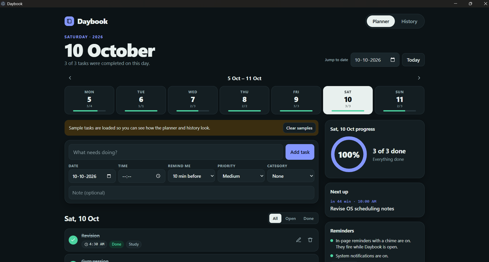
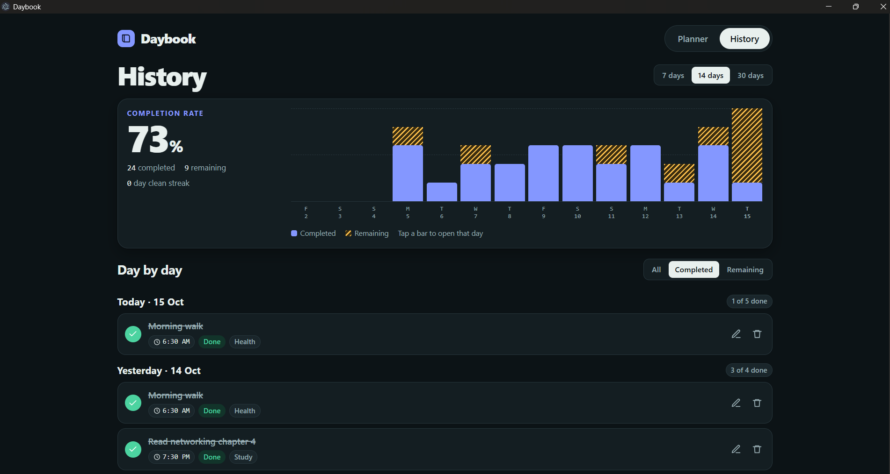
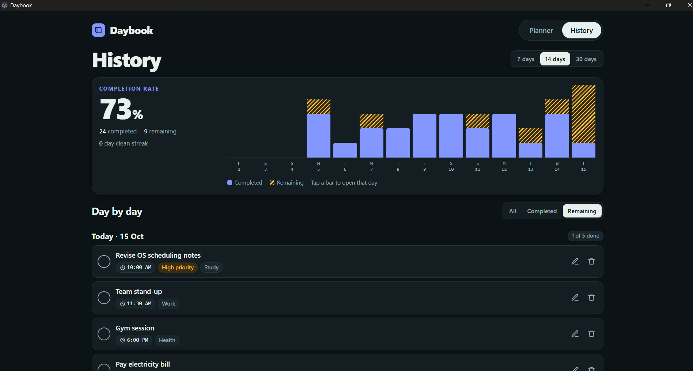

# 🗓️ Daybook Desktop

A **daily planner desktop application built using HTML, CSS, JavaScript, and Electron** to help users organize daily tasks, track progress, and review completed and remaining activities.

The project demonstrates practical implementation of **web technologies, task management, local storage, desktop application development, and Windows installer packaging**.

---

## 🚀 Features

* 📝 Add tasks for a selected date
* ⏰ Set task time and reminder preferences
* 🎯 Set task priority and category
* 📌 Add optional notes to tasks
* ✅ Mark tasks as completed
* ✏️ Edit and delete tasks
* 📊 View daily completion progress
* 📅 Navigate between dates
* 📈 View task history and completion statistics
* 🔎 Filter tasks by all, completed, or remaining
* 🔔 In-page reminders and desktop notifications
* 🖥️ Run as a Windows desktop application

---

## 🛠️ Technologies Used

* **HTML5** — application structure
* **CSS3** — styling and layout
* **JavaScript** — task management and application interactions
* **Electron** — desktop application runtime
* **electron-builder** — Windows installer packaging
* **Local Storage** — local task data persistence

---

## 📸 Application Screenshots

### Planner Dashboard

View daily tasks, add new activities, and track daily progress.



### History Dashboard

Review completion statistics and daily task history.



### Remaining Tasks

Focus on pending tasks, scheduled times, priorities, and categories.



> **Note:** Save the three screenshots in a folder named `screenshots` using the filenames `planner.png`, `history.png`, and `remaining-tasks.png`.

---

## 📁 Project Structure

```text
Daybook-Desktop/
│
├── screenshots/
│   ├── planner.png
│   ├── history.png
│   └── remaining-tasks.png
│
├── index.html
├── main.js
├── package.json
├── package-lock.json
├── README.md
├── Build-Daybook.bat
├── Run-Daybook.bat
├── PROJECT_STATUS.md
└── .gitignore
```

---

## ▶️ How to Run

### 1. Install Node.js

Download and install the [Node.js LTS version](https://nodejs.org/en/download).

### 2. Clone the Repository

```bash
git clone <repository-url>
```

### 3. Navigate to the Project Directory

```bash
cd Daybook-Desktop
```

### 4. Install Dependencies

```bash
npm install
```

### 5. Run the Application

```bash
npm start
```

---

## 🏗️ Build the Windows Installer

Run the following commands from the project directory:

```bash
npm install
npm run dist:win
```

The generated installer will be placed in the `release` folder.

On Windows, you can also double-click `Build-Daybook.bat` to build the installer.

---

## 💾 Data and Reminders

* Tasks are stored locally in the application's storage profile.
* Data is not automatically synchronized across computers.
* In-page reminders and desktop notifications depend on the application and Windows notification settings.
* Reminders are not guaranteed when Daybook is fully closed.

---

## 🧠 Concepts Demonstrated

* HTML page structure
* CSS styling and layout
* JavaScript event handling and application logic
* Task creation and management
* Local data persistence
* Electron desktop application development
* Windows installer packaging
* Project documentation with Markdown

---

## 🔮 Future Enhancements

* [ ] Add database-backed storage
* [ ] Add task export and import
* [ ] Improve reminder reliability when the app is closed
* [ ] Add backup and restore functionality
* [ ] Add automated tests
* [ ] Add cloud synchronization
* [ ] Publish versioned installers through GitHub Releases

---

## 🎯 Learning Objective

This project was developed to practice building a desktop application from web technologies and package it for Windows.

> **HTML + CSS + JavaScript + Electron = Daybook Desktop**

---

## 👨‍💻 Author

**Shubham Gadhe**

---

⭐ If you found this project useful, consider giving the repository a star!
